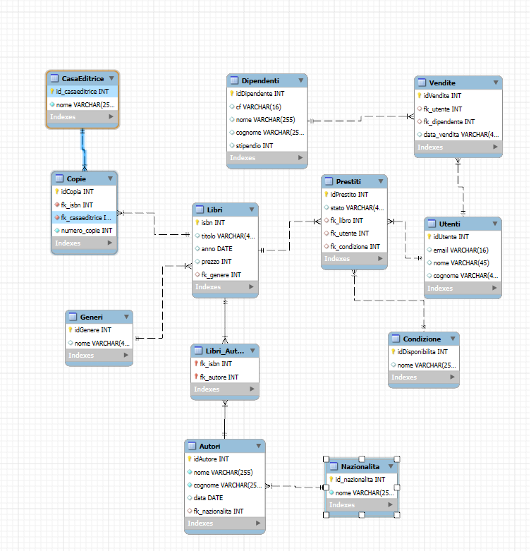

### N.B. ✨ Documentazione generata con GitHub Copilot   

# Libreria

Applicazione Spring Boot per la gestione di una biblioteca. Il progetto modella libri, autori, generi, nazionalità, copie e case editrici tramite JPA e mette a disposizione API REST per consultare autori, libri e copie e per inserire autori e libri.

> Gli endpoint descritti in questo documento sono esclusivamente quelli implementati nei controller presenti nel progetto. Le copie sono consultabili tramite API; case editrici, prestiti, utenti e dipendenti sono rappresentati nel dump SQL, ma non hanno controller REST dedicati.

## Schema del database



## Tecnologie utilizzate

- **Java 23**
- **Spring Boot 4.1.2**
- **Spring Web MVC**, per gli endpoint REST
- **Spring Data JPA**, per il mapping object-relational e i repository
- **Hibernate**, come implementazione JPA
- **MySQL**, database relazionale
- **Maven**, gestione del progetto e delle dipendenze
- **SpringDoc OpenAPI 3.2.0**, documentazione OpenAPI e interfaccia Swagger UI
- **Spring Boot DevTools**, disponibile a runtime per lo sviluppo

## Struttura del progetto

Il codice applicativo si trova in `src/main/java/com/example/libreria`:

```text
com.example.libreria
├── LibreriaApplication.java
├── controller/
│   ├── AutoreController.java
│   ├── CopiaController.java
│   └── LibroController.java
├── dto/
├── model/
├── repository/
├── service/
└── utility/
    └── Mapper.java
```

### Responsabilità dei componenti

- **Controller**: espongono gli endpoint HTTP e delegano le operazioni ai service.
- **Service**: contengono la logica applicativa. Verificano le relazioni richieste, recuperano i dati associati tramite repository, salvano le entity e convertono il risultato in DTO.
- **Repository**: interfacce Spring Data JPA basate su `JpaRepository`. Sono presenti repository per autori, libri, generi, nazionalità, case editrici e copie.
- **Entity/Model**: classi annotate con `@Entity` che rappresentano le tabelle gestite dal mapping JPA.
- **DTO**: oggetti usati per trasferire dati verso il client evitando di esporre direttamente le entity e impedendo ricorsioni nelle relazioni.
- **Mapper**: `utility.Mapper` converte entity e DTO. Nei DTO dei libri sono inclusi gli autori, mentre `AutoreDTO` non include la collezione dei libri.

## Modello applicativo e relazioni

### Entità

| Entità | Tabella | Campi principali | Relazioni |
|---|---|---|---|
| `Libro` | `Libri` | `isbn`, `titolo`, `anno`, `prezzo` | appartiene a un `Genere`; può avere molti `Autore` |
| `Autore` | `Autori` | `idAutore`, `nome`, `cognome`, `data` | appartiene a una `Nazionalita`; può scrivere molti `Libro` |
| `Genere` | `Generi` | `idGenere`, `nome` | un genere può essere associato a molti libri |
| `Nazionalita` | `Nazionalita` | `id_nazionalita`, `nome` | una nazionalità può essere associata a molti autori |
| `Copia` | `Copie` | `idCopia`, `numero_copie` | appartiene a un `Libro` e a una `CasaEditrice` |
| `CasaEditrice` | `CasaEditrice` | `id_casaeditrice`, `nome` | può essere associata a molte copie |

### Relazioni JPA

- **`Libro` — `Genere`**: `ManyToOne`, tramite `Libri.fk_genere`.
- **`Autore` — `Nazionalita`**: `ManyToOne`, tramite `Autori.fk_nazionalita`.
- **`Libro` — `Autore`**: `ManyToMany`, tramite la tabella di collegamento `Libri_Autori`, con chiavi `fk_isbn` e `fk_autore`.
- **`Copia` — `Libro`**: `ManyToOne`, tramite `Copie.fk_isbn`.
- **`Copia` — `CasaEditrice`**: `ManyToOne`, tramite `Copie.fk_casaeditrice`.

La relazione molti-a-molti tra libri e autori è utilizzata da entrambi i lati nelle entity. Nella rappresentazione DTO, invece, il mapper include gli autori dentro `LibroDTO` e non include i libri dentro `AutoreDTO`, così da evitare una ricorsione nella serializzazione JSON.

## API REST

L’applicazione usa come base URL `http://localhost:8080`. La porta `9090` è presente solo come configurazione commentata in `application.properties`, quindi il valore attivo predefinito è quello di Spring Boot.

### Elenco autori

```http
GET /autori/all
```

Non richiede parametri né body. Restituisce una lista di `AutoreDTO`.

Esempio di risposta:

```json
[
  {
    "idAutore": 7,
    "nome": "Italo",
    "cognome": "Calvino",
    "data": "1923-10-15",
    "nazionalitaDTO": {
      "id_nazionalita": 1,
      "nome": "Italiana"
    }
  }
]
```

### Inserimento autore

```http
POST /autori/addAutore
```

Parametri richiesti dal metodo del controller:

| Parametro | Tipo | Descrizione |
|---|---|---|
| `nome` | `String` | nome dell’autore |
| `cognome` | `String` | cognome dell’autore |
| `data` | `LocalDate` | data associata all’autore, nel formato `yyyy-MM-dd` |
| `nazionalita` | `String` | nome di una nazionalità già presente nel database |

Il metodo non dichiara `@RequestParam` e non usa `@RequestBody`: i valori sono quindi passati come parametri della richiesta secondo il binding di Spring MVC.

Esempio:

```bash
curl -X POST "http://localhost:8080/autori/addAutore?nome=Primo&cognome=Levi&data=1919-07-31&nazionalita=Italiana"
```

Esempio di risposta:

```json
{
  "idAutore": 11,
  "nome": "Primo",
  "cognome": "Levi",
  "data": "1919-07-31",
  "nazionalita": {
    "id_nazionalita": 1,
    "nome": "Italiana"
  }
}
```

La nazionalità deve esistere. In caso di errore nel service, l’implementazione attuale stampa lo stack trace e restituisce `null`.

### Inserimento libro

```http
POST /libri/addLibro
```

Parametri del metodo:

| Parametro | Tipo | Descrizione |
|---|---|---|
| `isbn` | `Integer` | identificativo ISBN del libro |
| `titolo` | `String` | titolo del libro |
| `data` | `LocalDate` | data/anno del libro, nel formato `yyyy-MM-dd` |
| `prezzo` | `Integer` | prezzo del libro |
| `genere` | `String` | nome di un genere già presente nel database |
| body | `Set<Integer>` | insieme degli `idAutore` da associare al libro |

Il body è l’unico parametro dichiarato con `@RequestBody`; gli altri valori sono parametri della richiesta.

Esempio:

```bash
curl -X POST "http://localhost:8080/libri/addLibro?isbn=100000021&titolo=Nuovo%20libro&data=2026-01-15&prezzo=18&genere=Romanzo" ^
  -H "Content-Type: application/json" ^
  -d "[7,8]"
```

Esempio di risposta:

```json
{
  "isbn": 100000021,
  "titolo": "Nuovo libro",
  "anno": "2026-01-15",
  "genere": {
    "idGenere": 3,
    "nome": "Romanzo"
  },
  "autori": [
    {
      "idAutore": 7,
      "nome": "Italo",
      "cognome": "Calvino",
      "data": "1923-10-15",
      "nazionalita": {
        "id_nazionalita": 1,
        "nome": "Italiana"
      }
    }
  ]
}
```

Il service verifica che tutti gli ID autore ricevuti esistano e che il genere indicato sia presente. Se una verifica fallisce, l’implementazione attuale stampa lo stack trace e restituisce `null`.

### Elenco libri in formato DTO

```http
GET /libri/allDTO
```

Non richiede parametri né body. Restituisce tutti i libri convertiti in `LibroDTO`.

Esempio di risposta:

```json
[
  {
    "isbn": 100000001,
    "titolo": "Il Signore degli Anelli",
    "anno": "1954-07-29",
    "genere": {
      "idGenere": 1,
      "nome": "Fantasy"
    },
    "autori": [
      {
        "idAutore": 1,
        "nome": "J.R.R.",
        "cognome": "Tolkien",
        "data": "1892-01-03",
        "nazionalita": {
          "id_nazionalita": 2,
          "nome": "Inglese"
        }
      }
    ]
  }
]
```

L’endpoint `/libri/all` è presente solo come codice commentato e non è quindi disponibile.

### Ricerca libri per titolo

```http
GET /libri/getbytitle/{titolo}
```

Restituisce una lista di `LibroDTO` con i titoli che contengono il valore specificato, senza distinguere tra maiuscole e minuscole. Non richiede body.

Esempio:

```bash
curl "http://localhost:8080/libri/getbytitle/signore"
```

### Consultazione copie

```http
GET /copie/all
GET /copie/allbynumcopie/{num_copie}
```

Il primo endpoint restituisce tutte le copie come lista di `CopiaDTO`; il secondo filtra per il valore esatto di `numero_copie` e restituisce la stessa struttura. Nessuno dei due richiede un body.

La risposta di `CopiaDTO` contiene l’identificativo, il libro (`libroDTO`), la casa editrice e il numero di copie. Il libro annidato ha la struttura di `LibroDTO`, inclusa la lista `autori`.

## Database

La configurazione predefinita utilizza:

- database: `Biblioteca`
- host: `localhost`
- porta MySQL: `3306`
- driver: `com.mysql.cj.jdbc.Driver`
- utente configurato: `root`
- schema JPA: `validate`

`spring.jpa.hibernate.ddl-auto=validate` indica che Hibernate verifica la compatibilità dello schema esistente senza crearlo o modificarlo automaticamente. Il file `sql/Dump20261104.sql` contiene lo schema e i dati di esempio del database.

### Tabelle principali del dump

- `Libri`: catalogo dei libri, con riferimento a `Generi`.
- `Autori`: autori, con riferimento a `Nazionalita`.
- `Libri_Autori`: tabella ponte per la relazione molti-a-molti tra libri e autori.
- `Generi`: elenco dei generi.
- `Nazionalita`: elenco delle nazionalità.
- `Copie`: quantità di copie per libro e casa editrice.
- `CasaEditrice`: case editrici.

Il dump contiene inoltre `Condizione`, `Prestiti`, `Utenti`, `Dipendenti` e `Vendite`. Queste tabelle hanno relazioni SQL con il resto dello schema, ma non sono mappate da entity presenti nel codice Java e non sono esposte dagli endpoint attuali.

### Relazioni SQL

```text
Nazionalita 1 ─── N Autori
Generi      1 ─── N Libri
Autori      N ─── N Libri       tramite Libri_Autori
Libri       1 ─── N Copie
CasaEditrice 1 ─ N Copie
Libri       1 ─── N Prestiti
Utenti      1 ─── N Prestiti
Condizione  1 ─── N Prestiti
Utenti      1 ─── N Vendite
Dipendenti  1 ─── N Vendite
```

Le ultime quattro relazioni appartengono allo schema SQL del dump, ma non sono gestite dal modello applicativo corrente.
