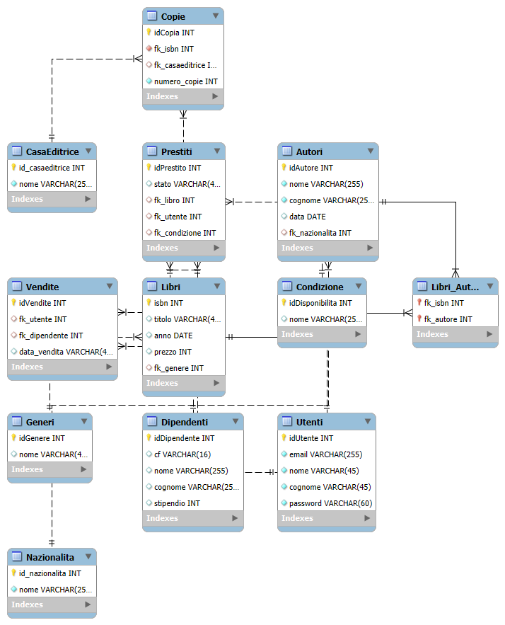

### N.B. ✨ Documentazione generata con GitHub Copilot   

# Libreria

Applicazione per la gestione di una biblioteca composta da un backend Spring Boot e da un frontend Angular. Il progetto modella libri, autori, generi, nazionalità, copie, case editrici e utenti tramite JPA e mette a disposizione API REST protette da autenticazione JWT.

> Gli endpoint descritti in questo documento sono quelli implementati nei controller presenti nel progetto. Prestiti, vendite, dipendenti e condizioni sono presenti nel dump SQL, ma non hanno ancora entity o controller REST dedicati.

## Schema del database



## Tecnologie utilizzate

- **Java 23**
- **Spring Boot 4.1.2**
- **Spring Web MVC**, per gli endpoint REST
- **Spring Data JPA**, per il mapping object-relational e i repository
- **Hibernate**, come implementazione JPA
- **Spring Security**, per la protezione delle API
- **JJWT 0.12.5**, per generare e verificare i token JWT
- **Spring Validation**, per validare i request body
- **MySQL**, database relazionale
- **Maven**, gestione del progetto e delle dipendenze
- **SpringDoc OpenAPI 3.2.0**, documentazione OpenAPI e interfaccia Swagger UI
- **Spring Boot DevTools**, disponibile a runtime per lo sviluppo
- **Angular 21**, per l'interfaccia web
- **TypeScript, RxJS e Angular Reactive Forms**
- **SweetAlert2**, per notifiche e dialog lato frontend

## Struttura del progetto

Il codice applicativo si trova in `src/main/java/com/example/libreria`, mentre il frontend si trova in `angular/Libreria`:

```text
com.example.libreria
├── LibreriaApplication.java
├── config/
│   └── SpringSecurityConfig.java
├── controller/
│   ├── AuthController.java
│   ├── AutenticatiController.java
│   ├── AutoreController.java
│   ├── CasaEditriceController.java
│   ├── CopiaController.java
│   ├── GenereController.java
│   └── LibroController.java
├── dto/
├── exception/
├── model/
├── repository/
├── security/
│   └── JwtAuthenticationFilter.java
├── service/
└── utility/
    └── Mapper.java
```

Il frontend Angular contiene componenti per login, dashboard, navigazione, catalogo, inserimento e modifica dei libri, oltre ai servizi per comunicare con il backend.

### Responsabilità dei componenti

- **Controller**: espongono gli endpoint HTTP e delegano le operazioni ai service.
- **Service**: contengono la logica applicativa. Verificano le relazioni richieste, recuperano i dati associati tramite repository, salvano le entity e convertono il risultato in DTO.
- **Repository**: interfacce Spring Data JPA basate su `JpaRepository`, con query per libri, autori, generi, nazionalità, case editrici, copie e utenti.
- **Entity/Model**: classi annotate con `@Entity` che rappresentano le tabelle gestite dal mapping JPA.
- **DTO**: oggetti usati per trasferire dati verso il client evitando di esporre direttamente le entity e impedendo ricorsioni nelle relazioni.
- **Mapper**: `utility.Mapper` converte entity e DTO. Nei DTO dei libri sono inclusi gli autori, mentre `AutoreDTO` non include la collezione dei libri.
- **Security**: `SpringSecurityConfig` configura CORS, sessioni stateless, BCrypt e autorizzazioni; `JwtAuthenticationFilter` verifica il token Bearer.
- **Exception handler**: `GlobalExceptionHandler` converte errori di validazione, risorse non trovate e conflitti in risposte JSON uniformi.

## Modello applicativo e relazioni

### Entità

| Entità | Tabella | Campi principali | Relazioni |
|---|---|---|---|
| `Libro` | `Libri` | `isbn`, `titolo`, `anno`, `prezzo` | appartiene a un `Genere`; può avere molti `Autore` |
| `Autore` | `Autori` | `idAutore`, `nome`, `cognome`, `data` | appartiene a una `Nazionalita`; può scrivere molti `Libro` |
| `Genere` | `Generi` | `idGenere`, `nome` | un genere può essere associato a molti libri |
| `Nazionalita` | `Nazionalita` | `id_nazionalita`, `nome` | una nazionalità può essere associata a molti autori |
| `Copia` | `Copie` | `idCopia`, `numero_copie` | appartiene a un `Libro` e a una `CasaEditrice` |
| `CasaEditrice` | `CasaEditrice` | `id_casaeditrice`, `nome` | può essere associata a molte copie |
| `Utente` | `Utenti` | `idUtente`, `email`, `nome`, `cognome`, `password` | account utilizzato per l'autenticazione |

### Relazioni JPA

- **`Libro` — `Genere`**: `ManyToOne`, tramite `Libri.fk_genere`.
- **`Autore` — `Nazionalita`**: `ManyToOne`, tramite `Autori.fk_nazionalita`.
- **`Libro` — `Autore`**: `ManyToMany`, tramite la tabella di collegamento `Libri_Autori`, con chiavi `fk_isbn` e `fk_autore`.
- **`Copia` — `Libro`**: `ManyToOne`, tramite `Copie.fk_isbn`.
- **`Copia` — `CasaEditrice`**: `ManyToOne`, tramite `Copie.fk_casaeditrice`.

La relazione molti-a-molti tra libri e autori è utilizzata da entrambi i lati nelle entity. Nella rappresentazione DTO, invece, il mapper include gli autori dentro `LibroDTO` e non include i libri dentro `AutoreDTO`, così da evitare una ricorsione nella serializzazione JSON.

## API REST

L’applicazione usa come base URL `http://localhost:8080`. La porta `9090` è presente solo come configurazione commentata in `application.properties`, quindi il valore attivo predefinito è quello di Spring Boot.

Tutti gli endpoint, esclusi `/autenticazione/**`, richiedono l'header:

```http
Authorization: Bearer <token-jwt>
```

### Autenticazione

#### Registrazione

```http
POST /autenticazione/register
Content-Type: application/json
```

```json
{
  "email": "mario@example.com",
  "nome": "Mario",
  "cognome": "Rossi",
  "password": "password"
}
```

La password viene cifrata con BCrypt. Se l'email è già presente viene restituito `409 Conflict`. In caso di successo la risposta contiene un token JWT:

```json
{
  "token": "<jwt>"
}
```

#### Login

```http
POST /autenticazione/login
Content-Type: application/json
```

```json
{
  "username": "mario@example.com",
  "password": "password"
}
```

Il campo `username` contiene l'email dell'utente. Il token ha una durata di 15 minuti.

#### Profilo autenticato di prova

```http
GET /autenticati/profilo
```

Restituisce `Wow! Sei autenticato!!!!` quando il JWT è valido.

### Autori

```http
GET    /autori
GET    /autori/num
GET    /autori/{id}
GET    /autori/{nome}/{cognome}
POST   /autori
PUT    /autori/{idAutore}
DELETE /autori/{idAutore}
```

`GET /autori` restituisce una lista di `AutoreDTO`; `/autori/num` restituisce il numero degli autori. L'inserimento e la modifica ricevono un `AutoreRequest`:

```json
{
  "nome": "Italo",
  "cognome": "Calvino",
  "data": "1923-10-15",
  "nazionalita": "Italiana"
}
```

La nazionalità viene cercata senza distinzione tra maiuscole e minuscole e, se necessario, inserita.

### Libri

```http
GET    /libri
GET    /libri/{isbn}
GET    /libri/num
GET    /libri/getallbytitle/{titolo}
GET    /libri/getbytitle/{titolo}
GET    /libri/getbyautore/{id}
GET    /libri/getbyautori?ids=1&ids=2
GET    /libri/getbygenere/{genere}
GET    /libri/getbyanno/{anno}
GET    /libri/getbyprezzo/{prezzo}
GET    /libri/getbyprezzomaggiore/{prezzo}
POST   /libri
PUT    /libri
DELETE /libri/{isbn}
```

`GET /libri` restituisce tutti i libri come `LibroDTO`. Le ricerche per titolo sono rispettivamente parziale (`getallbytitle`) ed esatta (`getbytitle`), entrambe senza distinzione tra maiuscole e minuscole. `getbyautori` accetta più parametri `ids` e restituisce i libri scritti da almeno uno degli autori indicati; `getbyanno` restituisce i libri fino all'anno richiesto; i due endpoint sul prezzo filtrano per valore esatto o maggiore/uguale.

Per inserimento e modifica il body è un `LibroRequest`:

```json
{
  "isbn": 100000021,
  "titolo": "Nuovo libro",
  "data": "2026-01-15",
  "prezzo": 18,
  "genere": "Romanzo",
  "autoriIDs": [7, 8]
}
```

Il genere viene creato automaticamente se non esiste; tutti gli autori indicati devono esistere. Un ISBN già presente produce `409 Conflict`. La cancellazione rimuove anche i collegamenti in `Libri_Autori` e le copie associate.

Esempio di risposta:

```json
{
  "isbn": 100000021,
  "titolo": "Nuovo libro",
  "anno": "2026-01-15",
  "prezzo": 18,
  "genere": {
    "idGenere": 3,
    "nome": "Romanzo"
  },
  "autori": [
    {
      "idAutore": 7,
      "nome": "Italo",
      "cognome": "Calvino",
      "data": "1923-10-15",
      "nazionalita": {
        "id_nazionalita": 1,
        "nome": "Italiana"
      }
    }
  ]
}
```

### Consultazione copie

```http
GET    /copie
GET    /copie/num
GET    /copie/allbynumcopie/{num_copie}
GET    /copie/allbycasaeditrice/{id}
GET    /copie/getbyisbn/{isbn}
GET    /copie/disponibili
GET    /copie/esaurite
POST   /copie
PUT    /copie/{idCopia}
DELETE /copie/{idCopia}
```

Il primo endpoint restituisce tutte le copie come lista di `CopiaDTO`; gli altri filtri consentono di cercare per quantità, casa editrice, ISBN, disponibilità o esaurimento. La risposta contiene l'identificativo, il libro (`LibroDTO`), la casa editrice e il numero di copie.

Per inserimento e modifica:

```json
{
  "isbn": 100000021,
  "casaEditrice": "Einaudi",
  "numeroCopie": 4
}
```

Il libro deve esistere; la casa editrice viene creata automaticamente se non è già presente.

### Generi

```http
GET    /generi
GET    /generi/num
GET    /generi/{id}
POST   /generi
PUT    /generi/{id}?nuovoNome=Fantascienza
DELETE /generi/{id}
```

Il body di inserimento è:

```json
{
  "nome": "Fantascienza"
}
```

La cancellazione rimuove prima le associazioni del genere con i libri.

### Case editrici

```http
GET /case
GET /case/num
```

Le case editrici sono consultabili e conteggiabili. Non esiste un endpoint dedicato per crearle: vengono inserite automaticamente quando si aggiunge una copia con una casa editrice nuova.

### Errori e validazione

Le request annotate con `@Valid` controllano i campi obbligatori. Gli errori gestiti da `GlobalExceptionHandler` hanno questa struttura:

```json
{
  "stato": 404,
  "errore": "Not Found",
  "messaggio": "Libro non trovato."
}
```

Sono utilizzati principalmente `400 Bad Request` per dati non validi, `401 Unauthorized` per JWT assente o non valido, `404 Not Found` per risorse mancanti e `409 Conflict` per libri o utenti già esistenti.

## Frontend Angular

Il frontend si trova in `angular/Libreria` ed è disponibile su `http://localhost:4200`.

### Funzionalità

- login e logout con JWT;
- salvataggio del token in `localStorage`;
- guardia sulle rotte protette;
- interceptor che aggiunge il token alle richieste e reindirizza al login dopo una risposta `401`;
- dashboard con il numero di libri, autori, copie, generi e case editrici;
- catalogo libri con ISBN, titolo, data, genere, prezzo e autori;
- inserimento libro con selezione di più autori;
- modifica libro tramite ISBN nella URL o tramite dialog SweetAlert;
- layout con header e sidebar di navigazione.

### Rotte

| Rotta | Componente | Descrizione |
|---|---|---|
| `/login` | `LoginComponent` | login/logout |
| `/` | `Home` | dashboard e azioni rapide, protetta |
| `/libri/mostracatalogo` | `MostraCatalogo` | catalogo libri, protetta |
| `/libri/addLibro` | `AggiungiLibro` | inserimento libro, protetta |
| `/libri/modificalibro/:id` | `ModificaLibro` | modifica tramite ISBN, protetta |
| `/libri/modificalibro` | `ModificaLibro` | richiesta ISBN tramite dialog, protetta |
| `/autori` | `AutoriComponent` | pagina predisposta |
| `/generi` | `GeneriComponent` | pagina predisposta |
| `/copie` | `CopieComponent` | pagina predisposta |
| `/case` | `CaseEditriciComponent` | pagina predisposta |

Le pagine di autori, generi, copie e case editrici sono attualmente placeholder. Anche le azioni rapide per aggiungere copie/generi/case editrici e cercare libri sono predisposte nell'interfaccia, ma non tutte hanno ancora una rotta dedicata.

### Avvio

```bash
cd angular/Libreria
npm install
npm start
```

Build di produzione:

```bash
npm run build
```

Il progetto Angular usa SSR, ma il rendering delle rotte è configurato in modalità client perché l'autenticazione legge il token da `localStorage`.

## Database

La configurazione predefinita utilizza:

- database: `Biblioteca`
- host: `localhost`
- porta MySQL: `3306`
- driver: `com.mysql.cj.jdbc.Driver`
- utente configurato: `root`
- schema JPA: `validate`

`spring.jpa.hibernate.ddl-auto=validate` indica che Hibernate verifica la compatibilità dello schema esistente senza crearlo o modificarlo automaticamente. La password del database deve essere configurata localmente. Il file `sql/Dump20261104.sql` contiene lo schema e i dati di esempio del database.

### Tabelle principali del dump

- `Libri`: catalogo dei libri, con riferimento a `Generi`.
- `Autori`: autori, con riferimento a `Nazionalita`.
- `Libri_Autori`: tabella ponte per la relazione molti-a-molti tra libri e autori.
- `Generi`: elenco dei generi.
- `Nazionalita`: elenco delle nazionalità.
- `Copie`: quantità di copie per libro e casa editrice.
- `CasaEditrice`: case editrici.
- `Utenti`: account utilizzati per l'autenticazione.

Il dump contiene inoltre `Condizione`, `Prestiti`, `Dipendenti` e `Vendite`. Queste tabelle hanno relazioni SQL con il resto dello schema, ma non sono mappate da entity presenti nel codice Java e non sono esposte dagli endpoint attuali.

### Relazioni SQL

```text
Nazionalita 1 ─── N Autori
Generi      1 ─── N Libri
Autori      N ─── N Libri       tramite Libri_Autori
Libri       1 ─── N Copie
CasaEditrice 1 ─ N Copie
Libri       1 ─── N Prestiti
Utenti      1 ─── N Prestiti
Condizione  1 ─── N Prestiti
Utenti      1 ─── N Vendite
Dipendenti  1 ─── N Vendite
```

Le ultime quattro relazioni appartengono allo schema SQL del dump, ma non sono gestite dal modello applicativo corrente.

### Avvio del backend

Dalla root del repository:

```bash
mvnw.cmd spring-boot:run
```

Oppure:

```bash
mvnw.cmd clean package
java -jar target/libreria-0.0.1-SNAPSHOT.jar
```

Swagger UI è disponibile all'indirizzo `http://localhost:8080/swagger-ui.html`, mentre la specifica OpenAPI è disponibile su `http://localhost:8080/v3/api-docs`.
